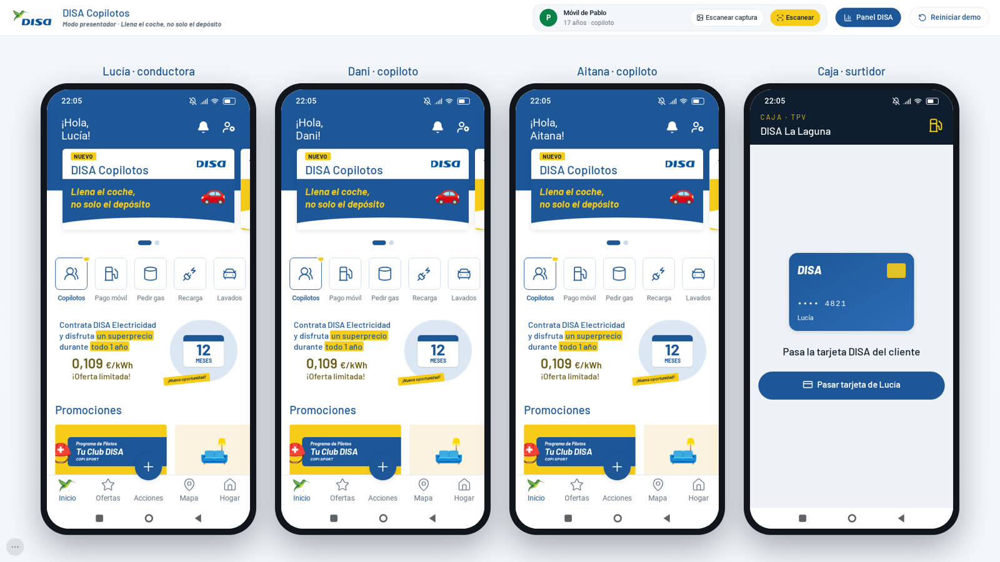
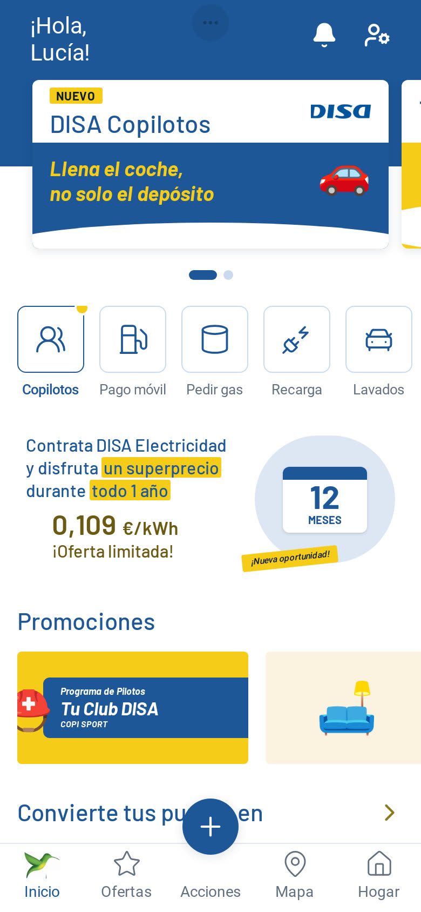
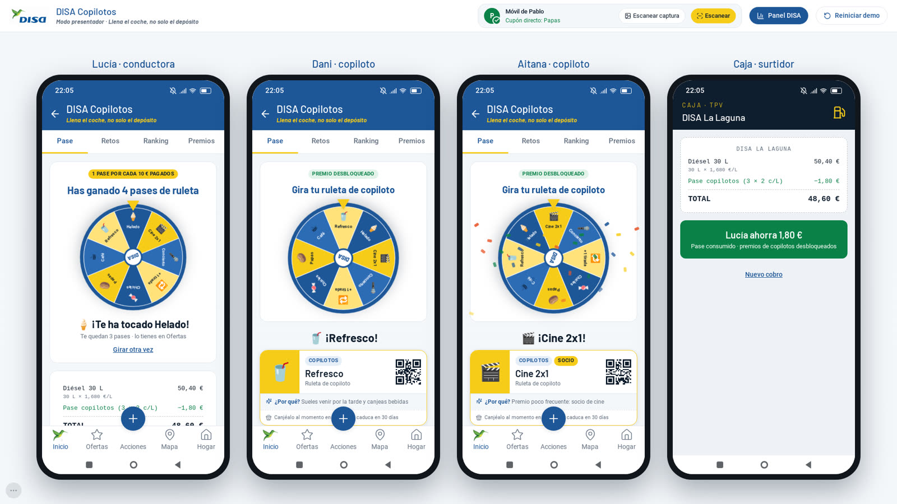
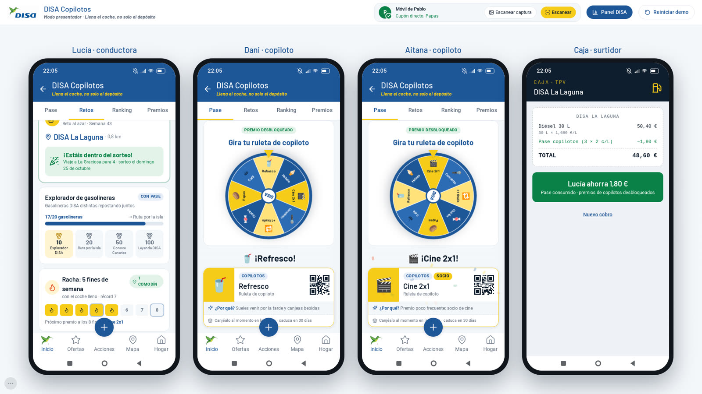
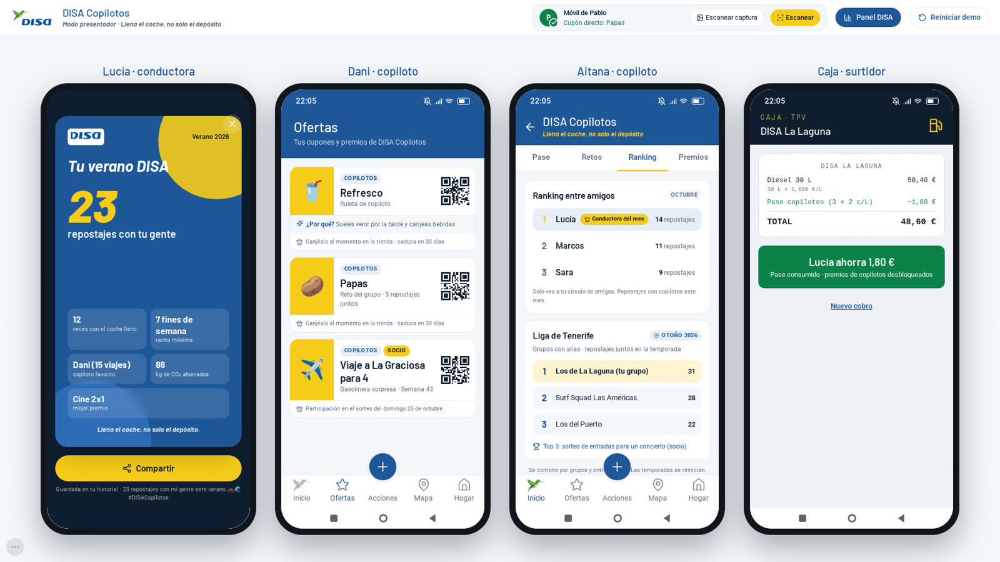
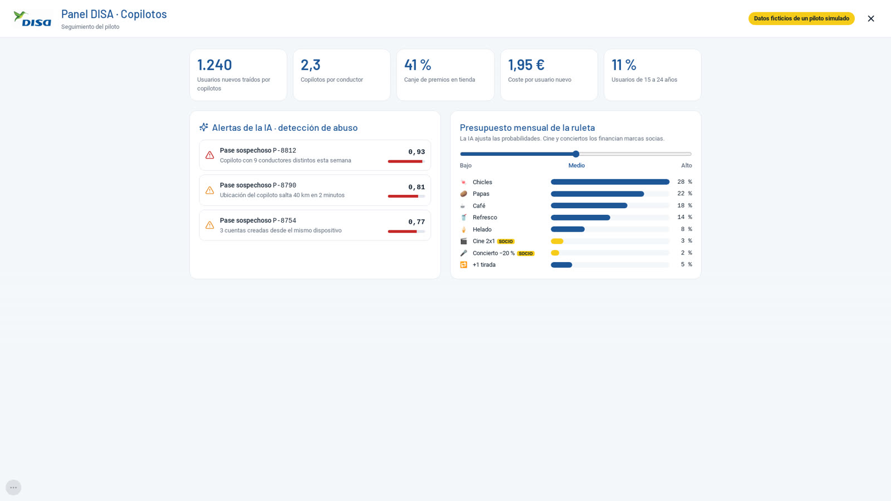

<div align="center">

# 🚗 DISA Copilotos

### *Llena el coche, no solo el depósito.*

**Propuesta del equipo TPBL para el reto de DISA en el Hackatón Zetta10 2026**




</div>

---

## 🏁 El hackatón

En el **Hackatón Zetta10 2026**, DISA planteó un reto abierto: **cómo debe evolucionar su modelo de negocio de aquí a 2035**.

Nos centramos en un problema concreto: los jóvenes de 15 a 24 años apenas usan la app de DISA, y las gasolineras *low-cost* ganan terreno. Además, cuando un grupo de amigos llega a una estación, DISA solo tiene un cliente: quien conduce.

**¿Y si pudiéramos conectar con los cuatro?**

## 💡 La propuesta

**DISA Copilotos** es una función integrada en la app oficial de DISA que convierte cada repostaje en una experiencia compartida:

| | |
|---|---|
| **1. Se conectan en el coche** | Quien conduce genera un **QR rotativo** que cambia cada 5 s. Sus amigos lo escanean desde su propia app y se unen como copilotos (hasta 3). |
| **2. Pase de copilotos** | Se activa un pase de 30 minutos: **2 céntimos menos por litro por cada copiloto**. |
| **3. En caja** | Al pagar con la tarjeta DISA, el pase se detecta solo. Quien conduce elige **descuento directo** o **acumular puntos**. |
| **4. Todos ganan** | Los copilotos desbloquean una **ruleta de premios o un cupón** que se canjea al momento en la tienda de la estación. Quien conduce gana pases de ruleta según lo que paga. |
| **5. Vuelven juntos** | Retos de grupo, rachas de fines de semana, ranking entre amigos, liga de grupos por isla, gasolinera sorpresa y una tarjeta **"Tu verano DISA"** para compartir en redes. |

**Para DISA:** fidelización colectiva, nuevos usuarios orgánicos (cada conductor trae hasta 3 amigos a la app) y más vida y más ventas en la tienda de cada estación.

> *Porque el viaje se comparte… y las ventajas también.*

## 📱 La demo

Construimos una **demo visual e interactiva** que replica el estilo de la app oficial de DISA y simula el recorrido completo de punta a punta.

<table>
  <tr>
    <td width="26%" align="center"><br><sub>Integración en el inicio de la app</sub></td>
    <td width="74%" align="center"><br><sub>Premios para los copilotos y descuento en caja</sub></td>
  </tr>
  <tr>
    <td colspan="2" align="center"><br><sub>Retos del grupo, gasolinera sorpresa y explorador de gasolineras</sub></td>
  </tr>
</table>

**Qué incluye**

- 🏠 **Integración en la app oficial**: tarjeta en el carrusel de inicio, acceso directo, acción en el botón central y cupones en *Ofertas*.
- 🔄 **QR rotativo** con cuenta atrás, unión de copilotos en tiempo real y pase activo con temporizador.
- 🧾 **Simulador de caja**: tarjeta DISA, litros, ticket con el pase aplicado y elección entre descuento o puntos.
- 🎡 **Ruleta de premios** animada y cupones con QR para canjear en tienda; los menores reciben un premio directo, sin ruleta.
- 🏆 **Gamificación cooperativa**: retos del grupo, racha con comodín, ranking entre amigos, liga por isla, Reto de Verano, explorador de gasolineras y gasolinera sorpresa con sorteo.
- 📸 **"Tu verano DISA"**: resumen del verano en formato historia (9:16), listo para compartir.
- 📊 **Panel DISA**: métricas del piloto, alertas antifraude por IA y control del presupuesto de la ruleta.
- 🛡️ **Seguridad escenificada**: QR de un solo uso (las capturas se rechazan), distancia máxima al conductor, un uso al día, mínimo de litros, caducidad del pase y premios que solo se desbloquean tras un repostaje real.
- 🎬 **Modo presentador**: cuatro móviles en una sola pantalla que reaccionan a la vez, con un menú oculto para lanzar cada escena durante la presentación.

<p align="center">
  
  
</p>

## 🛠️ Tecnología

| Área | Herramientas |
|---|---|
| Frontend | React 18, TypeScript, Vite |
| Estilos | Tailwind CSS con los colores de marca DISA como tokens, Roboto y Barlow incluidas en el proyecto (funciona sin conexión) |
| Estado | Zustand: un único estado compartido por todos los móviles y sincronizado entre pestañas |
| Componentes | `qrcode.react` (QR), ruleta animada en SVG, `lucide-react` (iconos) |
| Calidad | Vitest (cuadre de cifras y reglas de negocio) y Playwright (recorrido completo de la demo con capturas) |

Es una demo **sin backend**: todos los datos son ficticios y viven en `src/data/`, y las reglas de negocio están centralizadas en `src/data/config.ts`. En producción haría falta un backend con QR firmados y validados en servidor, geolocalización real, verificación del dispositivo, integración con la caja de la estación y con el sistema de puntos de DISA.

## 🚀 Cómo ejecutarlo

```bash
npm install
npm run dev
```

Abre **<http://localhost:5173/demo>** para el modo presentador. También hay una ruta por rol, pensada para enseñarla en un móvil real:

| Ruta | Pantalla |
|---|---|
| `/demo` | Modo presentador (4 móviles) |
| `/conductor` | App de la conductora |
| `/copiloto/u2` · `/u3` · `/u4` | App de cada copiloto |
| `/caja` | Simulador de caja de la estación |
| `/panel` | Panel DISA |

Otros comandos: `npm run build` (compilación de producción) y `npm test` (tests).

<details>
<summary><b>Recorrido de la demo, paso a paso</b></summary>

1. **Conductora**: botón **+** → *Iniciar DISA Copilotos* → aparece el QR rotativo.
2. **Copilotos**: **+** → *Unirme como copiloto* → *Escanear*. Aparecen con ✓ en el móvil de la conductora.
3. Un copiloto prueba con una **captura** del QR → *"Código caducado, escanea el QR en directo"*.
4. **Conductora**: *OK · Crear pase* → *3 copilotos · 30:00 · −6 c/L*.
5. **Caja**: pasar la tarjeta → *Pase de copilotos detectado* → 30 L → **50,40 € − 1,80 € = 48,60 €**.
6. **Premios**: cada copiloto gira su ruleta y la conductora gana 4 pases de ruleta.
7. **Retos**, **Ranking** y **Tu verano DISA** en el hub de Copilotos.
8. **Panel DISA**: métricas, alertas de IA y presupuesto de la ruleta.

El botón **…** (o la tecla **M**) abre el menú oculto con las escenas de seguridad y los saltos entre pasos.

</details>

## 👥 Equipo TPBL

| | |
|---|---|
| 👤 | **Nicolas Trujillo** |
| 👤 | **Elisa-Marie Breeze** |
| 👤 | **Luis Perera** |
| 👤 | **Jorge Lorenzo** |

---

<sub>Proyecto desarrollado para el Hackatón Zetta10 2026. No es un producto oficial de DISA: la marca, el logotipo y el estilo de la app pertenecen a sus titulares y se usan solo con fines de demostración. Todas las cifras, métricas y usuarios de la demo son ficticios.</sub>
